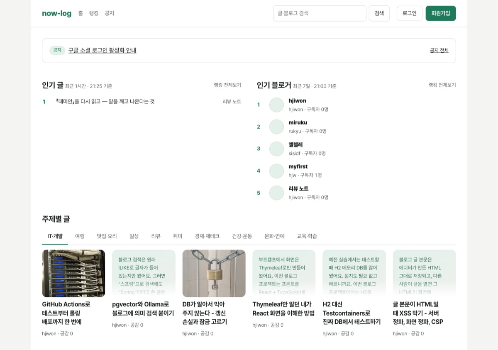
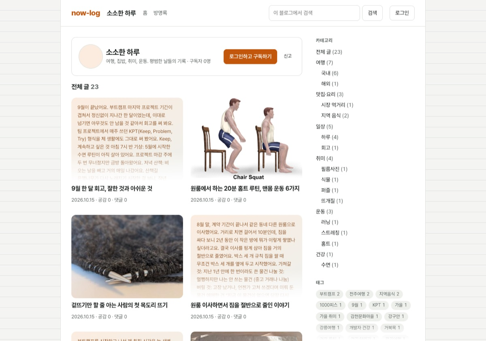
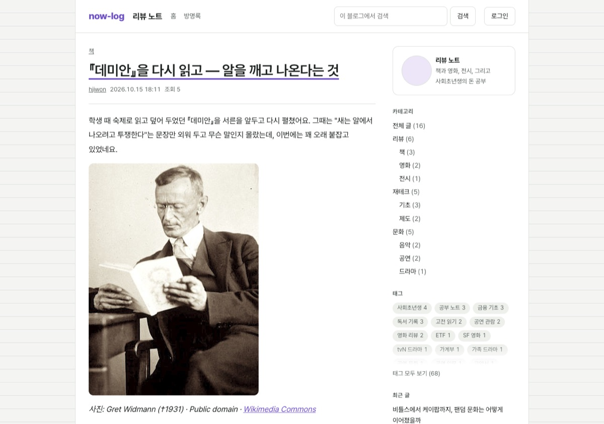
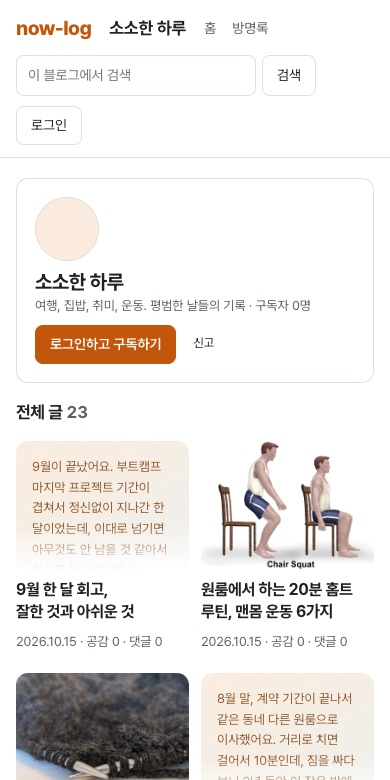
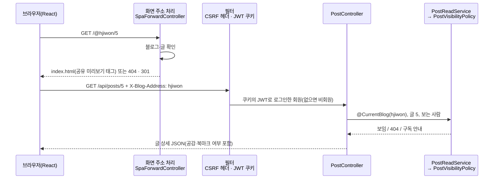

# now-log

[](https://github.com/blog-hjiwon203/now-log/releases)
[](https://github.com/blog-hjiwon203/now-log/actions/workflows/deploy.yml)
[](https://github.com/blog-hjiwon203/now-log/actions/workflows/sonar.yml)

티스토리형 멀티 블로그 서비스(지원). 누구나 가입해 자기 블로그(`/@주소`)를 열고, 에디터로 글을 발행하고, 다른 블로그 글을 읽고 댓글·공감·구독한다.

운영: https://now-log.java21.net

| 홈 | 블로그 첫 화면 |
| --- | --- |
|  |  |
| **글 상세** | **휴대폰** |
|  |  |

## 프로젝트 상태

2026-10-08에 시작해 2026-10-22 v1.1.0으로 마무리했다. 운영 사이트는 계속 돌고, main에 병합하면 지금처럼 배포된다.

- 작업 목록(blog-docs `tasks.md`) 163개를 모두 끝냈다. 스텝 1~25, 2주 범위와 백로그 포함
- 테스트: 백엔드 417개, 프론트 86개. SonarQube 품질 게이트 통과, 보안·신뢰성·유지보수성 A
- 운영: 앱 두 대 롤링 배포, 배포 중 요청 362번 모두 200

### 남은 일

| 할 일 | 내용 |
| --- | --- |
| 카테고리 순서를 키보드로 바꾸기 | 지금은 끌어 놓기로만 바꾼다. 위·아래 버튼을 더하면 SonarQube S6848 두 곳도 없어진다 |
| 백엔드 SonarQube 지적 43개 | record 패턴(S6878), 테스트의 `Thread.sleep`(S2925), 예약어 이름(S6213) 등 작은 정리. 게이트에는 영향 없음 |
| 목록 요약에 사진 출처가 섞임 | 본문 맨 앞이 사진 설명이면 요약도 "사진: …"으로 시작한다. 요약을 만들 때 `figcaption`을 뺄지 정해야 한다 |
| 화면 컴포넌트 테스트 | 화면(`.tsx`)은 캡처와 quickstart 시나리오로만 확인했고 커버리지 계산에서 뺐다. 필요하면 Testing Library로 시작 |

## 주요 기능

| 영역 | 기능 |
| --- | --- |
| 회원 | 이메일 인증 가입, 카카오·구글 로그인과 계정 연동, 로그인 유지(14일), 틀린 횟수 제한과 메일 잠금 풀기, 비밀번호 재설정, 탈퇴 |
| 블로그 | 한 사람이 5개까지, 대표 블로그, 스킨 3종·포인트 색·목록 형태, 사이드바 모듈 순서, 블로그 이사(옛 주소 301), 방명록 |
| 글 | Tiptap 에디터(마크다운 입력·붙여넣기), 이미지와 대표 이미지, 카테고리 2단계·태그·주제, 임시저장(1분 자동), 예약 발행, 공개·비공개·구독자 공개 |
| 읽기 | 홈(최신·인기 글, 인기 블로거, 주제별), 랭킹, 구독 피드, 글자 검색과 의미 검색, 비슷한 글 추천, 공감·저장·공유 |
| 소통 | 댓글·답글·비밀댓글, 알림, 차단과 금칙어 |
| 관리 | 내 글 관리(일괄 비공개·삭제·옮기기), 방문 통계와 유입 경로, 서비스 관리(정지·숨김·신고·공지·이력) |

볼 수 없는 글은 로그인 여부와 상관없이 404이고, 권한은 모두 서버에서 검사한다.

## 릴리스

버전마다 바뀐 것은 [CHANGELOG.md](CHANGELOG.md)와 [GitHub Releases](https://github.com/blog-hjiwon203/now-log/releases)에 있다.

| 버전 | 날짜 | 내용 |
| --- | --- | --- |
| [v1.1.0](https://github.com/blog-hjiwon203/now-log/releases/tag/v1.1.0) | 2026-10-22 | 화면 다듬기(글꼴·여백·한글 줄바꿈), SonarQube 프론트 지적 정리 |
| [v1.0.0](https://github.com/blog-hjiwon203/now-log/releases/tag/v1.0.0) | 2026-10-16 | 앱 두 대 롤링 배포(무중단), 예약 발행 경합 고침, SonarQube 분석 |
| [v0.4.0](https://github.com/blog-hjiwon203/now-log/releases/tag/v0.4.0) | 2026-10-14 | 의미 검색, DB를 PostgreSQL + pgvector 하나로 |
| [v0.3.0](https://github.com/blog-hjiwon203/now-log/releases/tag/v0.3.0) | 2026-10-12 | 첫 운영 배포, 블로그 주소를 `/@주소` 경로로, 소셜 로그인·통계·랭킹 |
| [v0.2.0](https://github.com/blog-hjiwon203/now-log/releases/tag/v0.2.0) | 2026-10-11 | 임시저장, 구독·알림, 방명록, 블로그 꾸미기, 서비스 관리 |
| [v0.1.0](https://github.com/blog-hjiwon203/now-log/releases/tag/v0.1.0) | 2026-10-10 | 가입 → 블로그 → 글 → 홈 → 댓글 한 바퀴 |

- 버전은 [유의적 버전](https://semver.org/lang/ko/)을 따르고, v1.0.0부터 `pom.xml`의 `<version>`과 태그를 맞춘다. 지금 main은 마지막 릴리스 `1.1.0`이다. 다시 개발을 시작하면 먼저 `pom.xml`을 다음 개발 버전(`1.2.0-SNAPSHOT`)으로 올린다.
- PR을 만들 때 `CHANGELOG.md`의 `[Unreleased]`에 한 줄씩 더한다. 릴리스할 때 그 절에 버전과 날짜를 붙이고 `pom.xml`을 같은 버전으로 바꾼 PR을 병합한 뒤, 그 병합 커밋에 태그(`git tag -a vX.Y.Z`)를 달고 GitHub Release를 만든다.
- 배포는 태그가 아니라 main 병합 때 일어난다. 태그는 이미 배포된 시점에 붙이는 이름표다.

## 코드 품질

- main에 병합되면 `sonar` 워크플로가 테스트를 커버리지와 함께 돌리고(백엔드 JaCoCo, 프론트 Vitest) 기관 SonarQube로 보낸다. 배포 워크플로와 따로 돌아서 분석이 실패해도 배포는 막히지 않는다.
- 품질 게이트는 새 코드 기준(Previous version, 즉 지금 `pom.xml` 버전 이후 바뀐 코드)으로 본다. 오탐으로 판단한 지적은 SonarQube 화면에서 이유를 적어 처리했다.
- 계층 방향과 인증 경계는 `ArchitectureTest`(ArchUnit)가 `./mvnw test` 때마다 검사한다(아래 구조 절).

## 문서

이 저장소는 과제 제출용 [AIP-1/blog-basic-AIGJ_01_017-blog](https://github.com/AIP-1/blog-basic-AIGJ_01_017-blog)에서 커밋 기록째 옮겨 왔다(2026-10-14). 커밋 메시지의 `Merge pull request #1`~`#39`는 그 저장소의 PR이고, PR 본문과 리뷰는 blog-docs `history/pull-requests/`에 옮겨 두었다.

명세·계획·작업 목록·학습 자료는 별도 문서 저장소(blog-docs)에 있다. 옆 폴더 `../blog-docs`의 `specs/001-tistory-blog/`를 본다.

| 문서 | 내용 |
| --- | --- |
| `spec.md` | 기능 명세(수용 시나리오) |
| `contracts/rest-api.md` | REST API |
| `data-model.md`, `erd/schema.sql` | 데이터 모델, 테이블 |
| `tasks.md` | 작업 목록과 구현 스텝 |
| `quickstart.md` | 로컬 실행과 손으로 확인하는 시나리오 |
| `learning/` | 스텝별 학습 자료(문서 저장소 맨 위, 파일 이름은 한글) |

## 기술

- 백엔드: Java 21, Spring Boot 4.1(Web MVC, Security, Data JPA, Validation, Cache, Data Redis, Flyway), Maven
- DB: PostgreSQL 17 + pgvector(주 데이터와 글 임베딩, 스텝 23에서 MySQL을 합침), Redis 7.4(캐시·연타 방지·시도 제한)
- 임베딩: Ollama + bge-m3(로컬)
- 프론트: React + TypeScript + Vite, Tiptap 에디터, 글꼴 Pretendard(npm으로 함께 빌드). 스타일은 CSS 변수를 쓴 `frontend/src/index.css` 하나이고, 블로그 꾸미기는 포인트 색 변수(`--brand`)와 `html[data-skin]`을 바꾼다. 빌드 결과를 jar 안 `static/`에 넣어 한 서버로 배포한다
- 테스트: JUnit 5, MockMvc, Testcontainers(PostgreSQL pgvector·Redis), ArchUnit, Vitest
- 배포·품질: GitHub Actions(테스트 → Docker 이미지 → 앱 두 대 롤링 배포), SonarQube, JaCoCo

## 실행

모두 이 저장소 맨 위 폴더에서.

```bash
docker compose up -d                 # PostgreSQL(pgvector), Redis, Ollama
./scripts/build-frontend.sh          # 프론트를 빌드해 src/main/resources/static으로 복사
./mvnw spring-boot:run               # http://blog.test:8080 (처음 뜰 때 Flyway가 테이블 생성)
```

- 플랫폼은 `http://blog.test:8080`, 블로그는 그 아래 `http://blog.test:8080/@{주소}`다(스텝 21). `/etc/hosts`에 `127.0.0.1 blog.test` 한 줄이면 된다(`quickstart.md`).
- Ollama는 이미 만들어 둔 docker 볼륨 `ollama`를 쓴다(`docker-compose.yml`의 `external: true`). 없으면 `docker volume create ollama` 뒤 `docker exec blog-ollama ollama pull bge-m3`.
- Ollama가 꺼져 있어도 서버는 뜬다. 그동안 쓴 글은 비슷한 글 추천만 비어 있고(의미 검색은 503 안내), 다음에 서버가 뜰 때 채운다.

프론트를 고치면서 볼 때는 개발 서버를 쓴다(`/api`를 8080으로 넘김).

```bash
cd frontend && npm install && npm run dev     # http://blog.test:5173
```

## 테스트

```bash
./mvnw test                  # Docker가 켜져 있어야 한다(Testcontainers가 임시 DB를 띄움)
cd frontend && npm test      # Vitest
```

테스트는 위 개발 DB를 건드리지 않는다. 임베딩은 진짜 모델 대신 가짜를 쓴다.

## 개발용 접속 정보

`docker-compose.yml`, `src/main/resources/application-dev.yml`의 개발용 값이다. 운영(prod 프로필)에서는 모두 환경 변수로 준다.

| 대상 | 주소 | 계정 |
| --- | --- | --- |
| PostgreSQL | `localhost:5432`, DB `blog` | `blog` / `blog` |
| Redis | `localhost:6379` | 없음 |
| Ollama | `http://localhost:11434` | 없음 |
| 서비스 관리자 | `blog.test:8080/login` | `admin@blog.test` / `admin1234!` (Flyway `V2__admin_account.sql`, 운영 전에 바꿀 것) |

운영 환경 변수: `DB_URL`(`jdbc:postgresql://…`), `DB_USERNAME`, `DB_PASSWORD`, `REDIS_HOST`, `REDIS_PORT`, `REDIS_PASSWORD`, `OLLAMA_URL`, `APP_RECOMMEND_ENABLED`, `JWT_SECRET`, `APP_UPLOAD_DIR`, `APP_PLATFORM_DOMAIN`. 실습 서버에서는 `deploy/deploy.sh`가 GitHub secrets로 채운다. 앱은 두 대(`aigj017-app` 8460, `aigj017-app-2` 8461)를 띄우고 학교 nginx upstream이 나눠 보내며, 배포는 한 대씩 바꾸고 `/actuator/health/readiness`가 UP인지 본 뒤 다음 앱으로 넘어간다(롤링, 실패하면 옛 이미지로 되돌림). 운영 데이터를 MySQL에서 옮길 때는 `deploy/migrate-from-mysql.sh`(스텝 24).

## 배포용 jar

```bash
./scripts/build-frontend.sh && ./mvnw clean package     # target/blog-*.jar
java -jar target/blog-*.jar --spring.profiles.active=prod
```

## 구조

```
src/main/java/com/nhnacademy/blog/
  global/
    config/       설정(보안, 캐시, 비동기, 화면 주소 처리 SpaForwardController)
    host/         블로그 주소 해석(`/@주소`, API의 `X-Blog-Address` 헤더 → @CurrentBlog)
    visibility/   글·블로그 가시성 판단(PostVisibilityPolicy, 목록용 PostSpecifications)
    auth/         다른 기능이 쓰는 인증 입구(LoginMember, LoginMembers, BlogOwnerGuard, 정지 안내)
    security/     본문 HTML 정화, CSP 헤더
    error/ entity/ web/   오류 응답, 생성·수정 시각, 페이지·커서·중복 요청 방지 같은 웹 도구
  auth/           로그인 속(JWT, 쿠키, 필터, 비밀번호 해시, 시도 제한, 소셜 로그인)
  member/ blog/ post/ category/ tag/ comment/ reaction/ bookmark/ image/
  subscription/ notification/ search/ recommend/ home/ ranking/ manage/ admin/
src/main/resources/db/migration/   Flyway(V1__init.sql = blog-docs erd/schema.sql)
frontend/src/                      React 앱(app/ 라우터, pages/, components/, api/, index.css 화면 스타일)
docs/screenshots/                  README 화면 사진
deploy/                            서버에서 실행하는 배포 스크립트
```

### 기능 패키지 안의 세 계층

```
post/
  presentation/   PostController, dto/        요청을 받아 응답 DTO로
       ↓
  application/    PostReadService ...         트랜잭션, 업무 규칙
       ↓
  domain/         Post, PostRepository ...    엔티티, enum, Repository
```

의존은 위에서 아래로만 간다. 여러 기능이 같이 쓰는 것은 `global/`에 둔다. 아래 규칙은 `ArchitectureTest`(ArchUnit)가 `./mvnw test` 때마다 검사한다.

- `domain`은 `application`·`presentation`을 모른다.
- `application`은 `presentation`을 모른다.
- 인증의 속(토큰, 쿠키, 필터, 비밀번호 해시 등)은 `auth/` 밖에서 쓰지 않는다. 다른 기능은 `global/auth/`의 입구와 `auth`의 `CredentialService`·`LoginSessions`만 쓴다.

### 한 요청이 지나가는 길: 글 읽기

브라우저가 `https://now-log.java21.net/@hjiwon/5`를 열면 두 단계를 거친다.



1. **화면 주소 단계** (`/api` 밖): 서버가 블로그와 글을 먼저 확인한다. 없거나 볼 수 없으면 404 상태로, 다른 블로그 소속 글이면 서버가 직접 301로 보낸다. 볼 수 있으면 React 앱(`index.html`)을 준다. 비회원도 볼 수 있는 글이면 head에 공유 미리보기(Open Graph) 태그도 넣는다.
2. **API 단계**: React가 `/api/posts/5`를 부르며 `X-Blog-Address` 헤더로 블로그를 알린다.
   - 필터가 상태를 바꾸는 요청(POST 등)이면 `X-Requested-With` 헤더를 확인하고(CSRF 방지), 쿠키의 JWT로 로그인한 회원을 정한다.
   - `@CurrentBlog`가 헤더를 블로그로 바꾼다.
   - `PostVisibilityPolicy`가 판단한다: ① 글이 있나 → ② 이 블로그 소속인가 → ③ 주인인가 → ④ 남이 볼 수 있나(공개 범위, 구독자 공개).
   - 볼 수 없으면 로그인 여부와 상관없이 404다. API에서는 다른 블로그 글도 301이 아니라 404다.
3. 본문을 보여 준 뒤 화면이 `POST /api/posts/5/views`로 조회를 남긴다(같은 사람이 5분 안에 다시 보면 세지 않음).

글을 저장하면 커밋된 뒤에 `PostEmbeddingListener`가 다른 스레드에서 Ollama로 임베딩을 만들어 pgvector에 넣는다. 비슷한 글 추천과 의미 검색은 이 임베딩을 쓴다. 저장 응답은 임베딩 계산을 기다리지 않는다.
